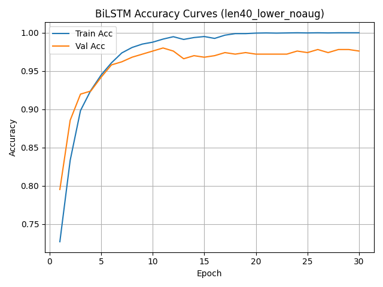
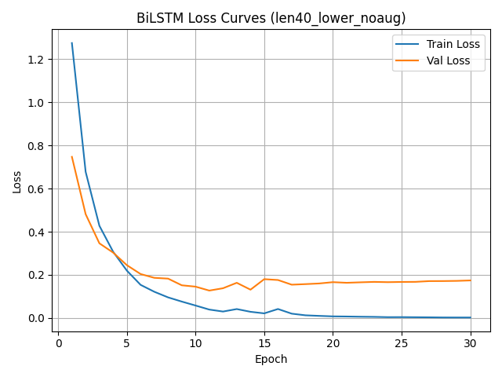
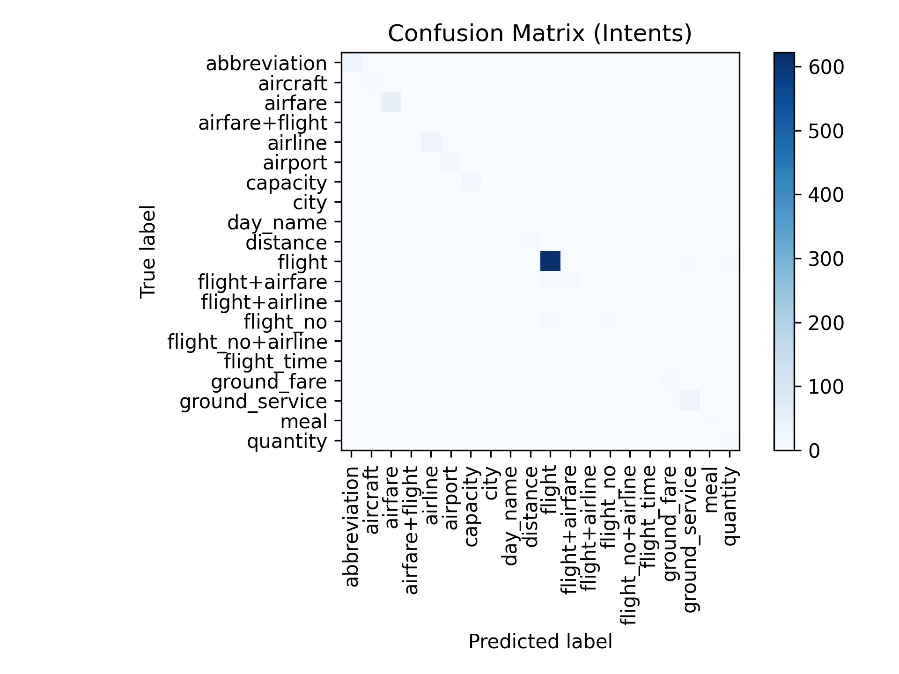

# Intent Classification with MLP, CNN, BiLSTM, and BERT

English | [简体中文](README.zh-CN.md)

This repository contains the implementation of our EE541 Final Project, where we build and compare multiple neural architectures for **intent classification** on the ATIS dataset.  
Our models include:

- **BiLSTM classifier** (our main experimental model)  
- **MLP baseline and CNN classifiers**  
- **BERT fine-tuning model**

The project includes data preprocessing, augmentation, model training, evaluation, and visualization of results such as confusion matrices and learning curves.

---

#  Repository Structure

```
EE541-Final-project/
│
├── models/                     # Define model
│   ├──BiLSTM_library/          # Generated during training; checkpoints are not included
│   |  └── ...
│   ├── __init__.py
│   └── bilstm.py
│
├── augmentation.py             # Data augmentation script
├── bert_model.py               # BERT fine-tuning implementation
├── data_loader.py              # Dataset & dataloader utilities for BiLSTM
├── eval_bilstm.py              # Evaluation script for BiLSTM
├── hdf5_read_test.py           # HDF5 group of BiLSTM dataset inspection tool
├── mlp_cnn_dataprocess.py      # Data preprocessing for MLP+CNN
├── mlp_cnn_model.py            # MLP+CNN model implementation
├── train_bilstm.py             # Main training script for BiLSTM
│
├── requirements.txt            # Python package dependencies
└── README.md
```

---

#  Installation & Environment Setup

### **1. Create environment**

```bash
conda create -n ee541 python=3.10 -y
conda activate ee541
```

### **2. Install dependencies**

```bash
pip install -r requirements.txt
```

Main packages include:

- PyTorch  
- NumPy  
- h5py  
- scikit-learn  
- matplotlib  
- transformers (for BERT)

---

#  Dataset Description

We use the **ATIS (Airline Travel Information System)** dataset for intent classification.

https://github.com/howl-anderson/ATIS_dataset

The dataset files are not included in this repository.
Create the `data/raw_data/` directory and place
`atis.train.pkl` and `atis.test.pkl` inside it.

Run all commands from the project root directory.

---

#  How to Run the Code

Run all commands from the project root directory.
The three model pipelines below can be run independently.

## **1. BiLSTM**

### Preprocess the data

Place `atis.train.pkl` and `atis.test.pkl` in `data/raw_data/`, then run:

```bash
python data_loader.py
```

In `data_loader.py`, set `MAX_LEN` to control the sequence length
and `use_augmentation` to enable or disable data augmentation.

For data augmentation, download the NLTK WordNet resources first:

```bash
python -m nltk.downloader wordnet omw-1.4
```

With `MAX_LEN = 40`, preprocessing saves the group
`len40_lower_noaug` when augmentation is disabled, or
`len40_lower_aug` when it is enabled.

### Inspect the HDF5 file (optional)

```bash
python hdf5_read_test.py
```

### Train the model

For the configuration without augmentation:

```bash
python train_bilstm.py --group_name len40_lower_noaug
```

To use class-weighted loss:

```bash
python train_bilstm.py --group_name len40_lower_noaug --use_class_weights
```

For augmented data, replace `len40_lower_noaug` with
`len40_lower_aug`. If you change `MAX_LEN`, update the group name
accordingly.

### Evaluate the model

Run the command that matches your training configuration.

**Baseline model:**

```bash
python eval_bilstm.py --group_name len40_lower_noaug --model_path models/BiLSTM_library/bilstm_len40_lower_noaug.pt --cm_fig_path figures/confusion_matrix_baseline.png
```

**Class-weighted model without augmentation:**

```bash
python eval_bilstm.py --group_name len40_lower_noaug --model_path models/BiLSTM_library/bilstm_len40_lower_noaug_cw.pt --cm_fig_path figures/confusion_matrix_class_weighted.png
```

**Model trained with augmented data:**

```bash
python eval_bilstm.py --group_name len40_lower_aug --model_path models/BiLSTM_library/bilstm_len40_lower_aug.pt --cm_fig_path figures/confusion_matrix_aug.png
```

The checkpoint and HDF5 group must match the training configuration.
If you change MAX_LEN, update both the group name and checkpoint path.
Each checkpoint must be generated by the corresponding training run
before evaluation.

## **2. MLP and CNN**

Preprocess the data:

```bash
python mlp_cnn_dataprocess.py
```

Then run the MLP and CNN experiments:

```bash
python mlp_cnn_model.py
```

## **3. BERT**

```bash
python bert_model.py
```

The script performs BERT tokenization internally.
Internet access is required on the first run to download
the pretrained tokenizer and model.

---

#  Model Architectures

### BiLSTM  
Embedding → BiLSTM → Dropout → Linear

### MLP
Embedding → Mean Pooling → Fully Connected Layers

### CNN
Embedding → Parallel Conv1D → Max Pooling → Linear Classifier

### BERT  
bert-base-uncased → Classification head

---

# Report and Results

[Read the final project report](docs/final_report.pdf)

## BiLSTM Training Curves

Training and validation curves for the configuration with a maximum
sequence length of 40, lowercasing, and no data augmentation.

### Accuracy


### Loss


## Confusion Matrix



---

#  Data Format

```
input_ids: (batch, max_len)
attention_mask: (batch, max_len)
labels: (batch,)
```

---

#  Authors and Contributions

**Huaitang Wang**
 - Build data preprocessing pipeline for BiLSTM (tokenization, lowercasing, padding/truncation)
 - Implement data augmentation (synonym replacement, random deletion/insertion)
 - Implement and train BiLSTM model
 - Experiment 1-5, 6, 8

**Xiaotian Zheng**
 - Build data preprocessing pipeline for MLP, CNN, BERT (4 kinds of tokenization, lowercasing, padding/truncation)
 - Implement and train MLP, CNN, BERT model
 - Experiment 6, 7, 8

---


