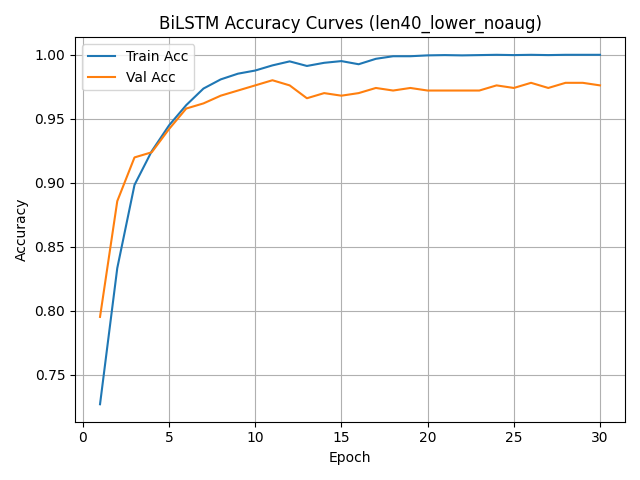
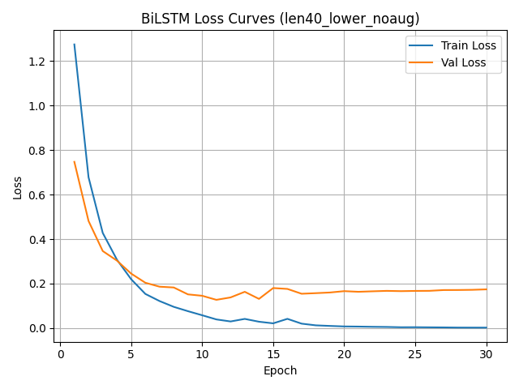
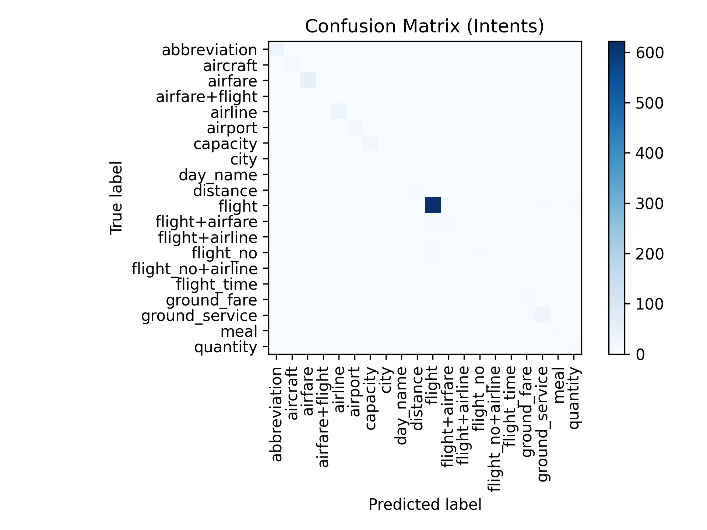

# 自然语言意图分类：MLP、CNN、BiLSTM 与 BERT

[English](README.md) | 简体中文

本项目是 USC EE541（A Computational Introduction to Deep Learning）课程的双人期末项目。我们在 ATIS 航空出行查询数据集上实现并评估 MLP、CNN、BiLSTM 和 BERT，研究模型结构、输入表示、数据增强及类别加权损失对意图分类的影响。

**王槐堂（Huaitang Wang） 主要负责 BiLSTM 数据预处理、数据增强、模型实现与训练，以及相关消融实验。** 其他模型由队友 Xiaotian Zheng 主要实现，具体分工见文末。

## 项目内容

- 实现四种意图分类模型，并提供训练与评估代码。
- 比较词级、字符级及基于后缀规则的子词表示，BERT 使用其预训练分词器。
- 围绕 BiLSTM 进行序列长度、词嵌入维度、数据增强及类别加权损失的消融实验。
- 使用准确率、Macro-F1、混淆矩阵和各类别指标评估模型，关注低频意图。

## 数据集

使用 ATIS（Air Travel Information System）数据集，原始训练集包含 4,978 条样本，测试集包含 893 条样本，项目按 26 类意图进行分类。

原项目使用的数据来源：[ATIS_dataset](https://github.com/howl-anderson/ATIS_dataset)。

数据文件不包含在本仓库中。请创建 `data/raw_data/`，将以下两个文件放入其中：

- `atis.train.pkl`
- `atis.test.pkl`

各模型使用独立的预处理与训练流程，设置并不完全一致。

## 目录说明

| 文件或目录 | 内容 |
|---|---|
| `augmentation.py` | WordNet 同义词替换、随机删除及插入 |
| `data_loader.py` | BiLSTM 预处理及 HDF5 数据生成 |
| `models/bilstm.py` | BiLSTM 分类器与 Dataset |
| `train_bilstm.py` | BiLSTM 训练、验证与权重保存 |
| `eval_bilstm.py` | BiLSTM 测试评估与混淆矩阵生成 |
| `hdf5_read_test.py` | HDF5 数据结构与样本检查 |
| `mlp_cnn_dataprocess.py` | MLP/CNN 数据预处理 |
| `mlp_cnn_model.py` | MLP 与 CNN 实验 |
| `bert_model.py` | BERT 分词与分阶段解冻微调 |
| `figures/` | 精选训练曲线与混淆矩阵 |
| `docs/final_report.pdf` | 完整项目报告 |
| `requirements.txt` | Python 依赖 |

`data/preprocessed_data/` 在 BiLSTM 预处理时生成；`models/BiLSTM_library/` 在训练保存权重时生成。数据集和训练权重不随仓库提供。

## 环境配置

建议创建独立的 Python 3.10 环境：

```bash
conda create -n ee541 python=3.10 -y
conda activate ee541
pip install -r requirements.txt
```

主要依赖包括 PyTorch、NumPy、h5py、scikit-learn、matplotlib、seaborn、NLTK 和 transformers。

**以下命令均在项目根目录运行。三条模型流程可分别执行，无需依次训练所有模型。** 首次运行 WordNet 或预训练模型下载需要网络访问。

## 运行方法

### 1. BiLSTM

#### 预处理

确认原始数据已放入 `data/raw_data/`。在 `data_loader.py` 中设置：

```python
MAX_LEN = 40
use_augmentation = False
```

准备 WordNet 资源：

```bash
python -m nltk.downloader wordnet omw-1.4
```

执行预处理：

```bash
python data_loader.py
```

输出文件为 `data/preprocessed_data/atis_preprocessed.h5`。最大长度为 40 时，不增强和增强的数据组分别为 `len40_lower_noaug`、`len40_lower_aug`。

可选的数据检查：

```bash
python hdf5_read_test.py
```

检查前，确认脚本中读取的组名与实际生成的数据组一致。

#### 训练

基线模型：

```bash
python train_bilstm.py --group_name len40_lower_noaug
```

使用类别加权损失：

```bash
python train_bilstm.py --group_name len40_lower_noaug --use_class_weights
```

使用增强数据时，先将 `use_augmentation` 设为 `True` 并重新运行预处理，然后训练：

```bash
python train_bilstm.py --group_name len40_lower_aug
```

调整词嵌入维度的示例：

```bash
python train_bilstm.py --group_name len40_lower_noaug --embed_dim 200
```

如修改 `MAX_LEN`，请重新生成对应数据组，并同步修改训练命令中的组名。

#### 评估

基线模型：

```bash
python eval_bilstm.py --group_name len40_lower_noaug --model_path models/BiLSTM_library/bilstm_len40_lower_noaug.pt --cm_fig_path figures/confusion_matrix_baseline.png
```

类别加权模型：

```bash
python eval_bilstm.py --group_name len40_lower_noaug --model_path models/BiLSTM_library/bilstm_len40_lower_noaug_cw.pt --cm_fig_path figures/confusion_matrix_class_weighted.png
```

增强模型：

```bash
python eval_bilstm.py --group_name len40_lower_aug --model_path models/BiLSTM_library/bilstm_len40_lower_aug.pt --cm_fig_path figures/confusion_matrix_aug.png
```

**权重文件必须先通过相应训练生成，且应与数据组匹配。** 类别加权不改变数据组，默认权重文件名增加 `_cw`。若自定义保存名称，请使用实际文件路径。

### 2. MLP 与 CNN

先生成预处理数据：

```bash
python mlp_cnn_dataprocess.py
```

再运行模型实验：

```bash
python mlp_cnn_model.py
```

预处理脚本在项目根目录生成 `ATIS_Word_traintest_data`、`ATIS_Char_traintest_data` 等 HDF5 文件，由模型脚本读取。

### 3. BERT

```bash
python bert_model.py
```

脚本自行将原始 token ID 转换为文本，使用 `bert-base-uncased` 分词器及模型进行微调。首次执行需要下载预训练资源。

微调分为四阶段：仅训练分类头、解冻最后两层、解冻最后四层，以及解冻全部 Transformer 层。

## 模型结构

| 模型 | 主要结构 |
|---|---|
| MLP | Embedding → Mean Pooling → 全连接分类器 |
| CNN | Embedding → 并行卷积（窗口 3/4/5）→ Max Pooling → 线性分类器 |
| BiLSTM | Embedding → 双向 LSTM → 提取最后有效位置输出 → Dropout → 线性分类器 |
| BERT | 预训练 BERT → 分类头，采用分阶段解冻微调 |

BiLSTM 使用 attention mask 确定有效序列长度并选择输出位置；它不直接屏蔽句子级分类损失，也不完全消除 padding 对双向 LSTM 的影响。

## 报告与实验结果

[阅读完整项目报告](docs/final_report.pdf)

以下为报告记录的 BiLSTM 实验结果，并非本次整理时重新训练所得：

| 设置 | 测试准确率 | Macro-F1 |
|---|---:|---:|
| 基线：长度 40，Embedding 100，不增强，不加权 | 94.85% | 0.5624 |
| 长度 30 | 95.41% | 0.6197 |
| 使用数据增强 | 94.62% | 0.6045 |
| 使用类别加权损失 | 95.63% | 0.6720 |

相较基线，类别加权损失的 Macro-F1 从 0.5624 提升到 0.6720，增加 0.1096；数据增强也提高了 Macro-F1，但准确率略降，且并非所有类别都受益。

### BiLSTM 训练曲线

以下曲线对应最大长度 40、小写、不使用数据增强的配置，分别展示训练集与验证集指标。验证准确率不等同于测试准确率。





### 混淆矩阵

以下为项目保留的意图分类混淆矩阵；文件名本身未标明具体实验配置。



## 数据格式

BiLSTM 的一个 batch 包含：

```text
input_ids:      (batch_size, max_len)
attention_mask: (batch_size, max_len)
labels:         (batch_size,)
```

该格式描述 BiLSTM 流程，不代表所有模型的输入接口完全相同。

## 实验限制

- 各模型的预处理、训练和验证设置不同，跨模型结果是对不同完整流程的描述性比较，不能视为严格受控的架构排名。
- BERT 实现在每轮训练后监测测试集，没有独立验证集；应结合这一限制解读报告结果。
- 未提供多次独立运行的置信区间，单次实验差异不能单独确定因果关系。
- 数据增强在划分 BiLSTM 训练/验证子集前执行，因此原样本及其增强版本可能落入不同子集；后续更严格的实验应先划分再仅增强训练子集。
- 仓库整理不等同于完整复现验证，实际指标取决于数据、随机性及运行环境。

## 作者与贡献

本项目由两人合作完成。

### 王槐堂（Huaitang Wang）

- 构建 BiLSTM 数据预处理流程，包括 token 映射、小写转换、padding 和截断。
- 实现同义词替换、随机删除和随机插入等数据增强。
- 实现并训练 BiLSTM 意图分类模型。
- 完成实验 E1–E5，参与 E6、E8。
- 参与项目交付物整理。

### Xiaotian Zheng

- 构建 MLP、CNN、BERT 的数据预处理流程。
- 实现并训练 MLP、CNN 和 BERT 模型。
- 完成或参与实验 E6、E7、E8。
- 参与项目交付物整理。
